# Nox redesign: two desktop directions (26 September 2026)

**Decision:** William chose the flat poster style (round 1, Signal), asked for
other themes (round 2), then for it to stay pirate themed (round 3), and
picked **Chart** (`nox-chart-desktop-v1`), to be implemented board and
interface both. Production plates and covers: `production/README.md`; the
shipped design: the Chart section at the top of `docs/DESIGN.md`.

William asked for a complete redesign of Nox, the one game whose artwork
still reads as AI generated (the painted Gilt Hold: treasure chest lid,
gold coins, skull in a tricorn, rat). Two directions, one desktop mockup each
(1536x1024), image generation only; he picks one before anything is built.
Concept mockups only: nothing here is integrated.

Both directions drop the generic pirate props and lean on deliberate design
decisions instead of painted clutter:

- **Signal**: flat mid-century modernist poster graphics built on the
  international maritime signal flags. The night harbour is seen straight
  from above as a flat plan; the table is the hatch cover of a moored barge;
  a lighthouse beam is the one light. The five suits take the signal colours
  (spades black, hearts red, clubs blue, diamonds yellow, Storm split
  yellow and black with a lightning bolt).
- **Lantern**: a real night flat-lay photograph, shot straight down, of the
  game laid out on the teak cockpit table of an old fishing boat, lit by one
  storm lantern beyond the far edge. The owner's belongings carry the world
  (a bakelite transistor radio, tarred rope, a sea chart, a compass, harbour
  water past the gunwale). Cards are linen-finish cream stock in deep inks;
  Storm is charcoal with silver foil.

Fixed elements taken from the running game: a flat, face-on rectangular play
surface with a calm rim for seat tags (viewer on the bottom rim left of
centre, others on the left, top and right rims), no chairs or people, four
clockwise direction arrows on the rim, the current trick in the middle with
each card nudged toward its player, the hand in one overlapping row at the
bottom with the selected card lifted, the die and the Shields and Salvage
tokens at the left of the hand, the confirm plate and Undo at its right,
back and the name top left, Menu top right, the round pill top centre. One
light direction per scene. Baked text allowed: Nox and Play; names (You,
Rook, Static, Moth), scores, card numerals and 2/4 are illustrative only.

Generated with `codex exec -m gpt-6-luna` (reasoning effort low), built-in
`$imagegen`, one image per run, fresh from text, no reference images
(`gen.sh`). Exact prompts: `prompts/`.

## nox-signal-desktop-v1

Prompt: [`prompts/nox-signal-desktop-v1.txt`](prompts/nox-signal-desktop-v1.txt)

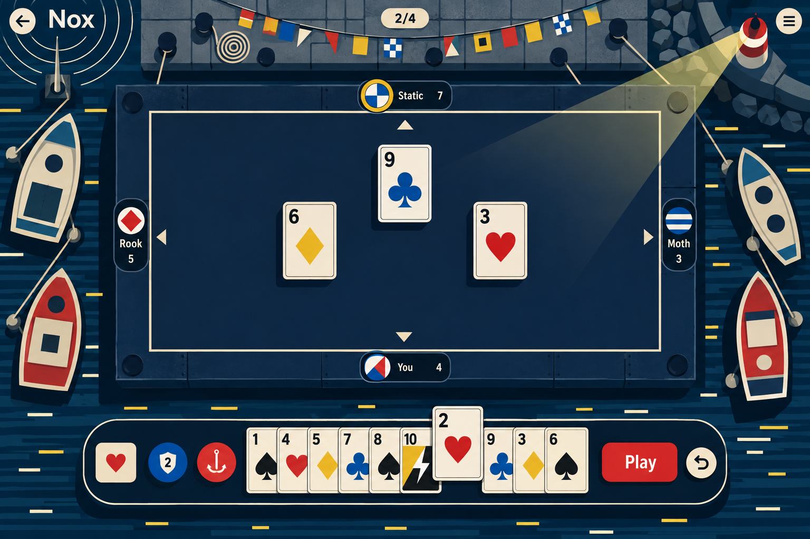

Self-check, first attempt: 1536x1024, one image in the Codex run. Baked text
limited to Nox, Play, 2/4, the four names, scores and card numerals. Present:
back and Nox top left, Menu top right, round pill top centre, flat plan hatch
with a calm rim, three rim tags plus the viewer's, the turn ring on Static,
the three-card trick nudged toward its players, ten cards in one overlapping
row with the lifted 2 of hearts, a Storm card (yellow and black with a bolt)
in the hand, heart die, shield token with 2, Play and Undo. Invented by the
model: an anchor instead of a grappling hook on the Salvage token, mooring
lines from the barge to bollards and boats, rivet bolts in the hatch corners.
Deviations: the four rim chevrons point outward rather than clockwise; the
viewer's tag is centred, not left of centre; side tags are drawn vertical.

## nox-lantern-desktop-v1

Prompt: [`prompts/nox-lantern-desktop-v1.txt`](prompts/nox-lantern-desktop-v1.txt)

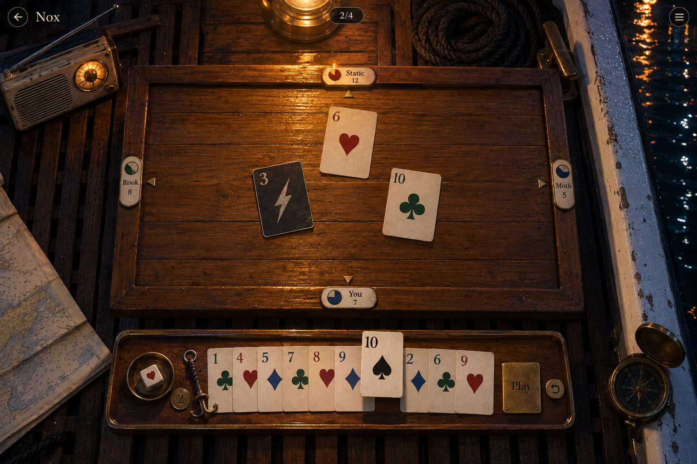

Self-check, first attempt: 1536x1024, one image in the Codex run. Baked text
limited to Nox, Play, 2/4, the four names, scores and card numerals, apart
from illegible micro-marks on the sea chart and the compass bezel. Present:
back and Nox top left, Menu top right, round pill top centre, face-on teak
table with a continuous fiddle-rail rim, four enamel tags on the rail, four
brass arrow inlays, the trick (a charcoal Storm 3, hearts 6, clubs 10) nudged
toward its players, ten cards in one overlapping row with the lifted 10 of
spades, the heart die in a brass dish, a brass 2 token, Play plate and Undo;
lantern at the top edge, bakelite radio, rope and cleat, chart, compass,
harbour water past the gunwale. Invented by the model: an iron anchor charm
instead of a grappling hook. Deviations: the arrows point outward rather than
clockwise; the viewer's tag is centred; the turn ring on Static is faint; the
seat tags read small at desktop size.

## Round 2: flat poster style, new themes

William preferred the flat graphic poster style of Signal but wanted other
themes. Four new themes, each drawn from its own poster tradition, all with
the same flat-shape rules (large clean shapes, flat colour, no texture, flat
offset shadows, one translucent shape of light) and the same game layout.
Every prompt now spells out the clockwise arrows (top points right, right
down, bottom left, left up), puts the viewer's tag about one third along the
bottom rim, asks for horizontal pill tags, a grappling-hook Salvage token and
one storm card in the hand, and rules out harbours and boats.

- **Rooftops**: a pirate radio station on a city roof at night as a flat
  rooftop map (1950s–60s city travel posters and magazine covers): water
  tower, skylights, antenna with radio arcs, street canyons with car lights.
- **Orbit**: a card game on a space station above the night side of the Earth
  (1960s space-age science and airline posters): solar wings, docking port,
  orbit arcs, the moon, city lights on the Earth.
- **Frost**: a swept skating rink on a frozen mountain lake at night (Swiss
  ski posters): pine stars, a hut roof with a lit window, ski tracks, aurora
  bands reflected on the ice.
- **Late Set**: the stage of a small jazz club after the last set (1950s–60s
  jazz record sleeves): drum kit circles, a grand piano from above, a double
  bass lying down, a trumpet, a checked floor, one spotlight.

### nox-rooftops-desktop-v1

Prompt: [`prompts/nox-rooftops-desktop-v1.txt`](prompts/nox-rooftops-desktop-v1.txt)

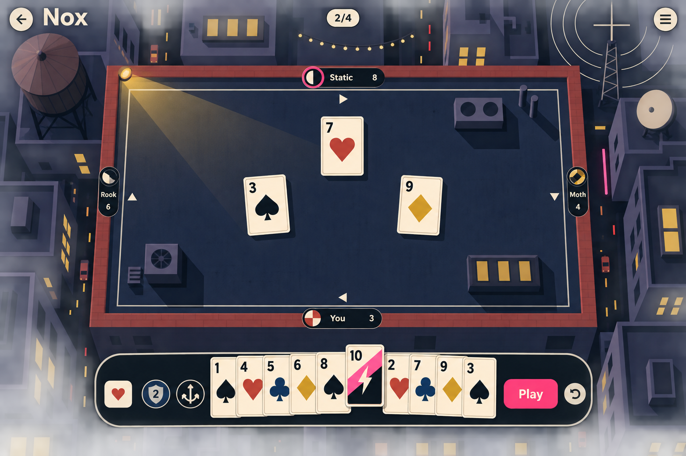

Self-check, first attempt: 1536x1024, one image in the run. Text limited to
the allowed words and illustrative names, scores, numerals and 2/4. Arrows
run clockwise, turn ring on Static, trick nudged toward its players, ten
cards with the lifted Storm 10 (neon pink and black with a bolt), heart die,
shield 2, Play and Undo. Water tower, floodlight wedge, string lights,
antenna with radio arcs, satellite dish, street canyons with car lights,
neon strip. Deviations: the viewer's tag is centred; rooftop vents and
skylights stand inside the play area, where cards would land (production
must keep the roof clear); the Salvage token reads as an anchor; the
surrounding buildings are drawn in shallow oblique with soft shading.

### nox-orbit-desktop-v1

Prompt: [`prompts/nox-orbit-desktop-v1.txt`](prompts/nox-orbit-desktop-v1.txt)

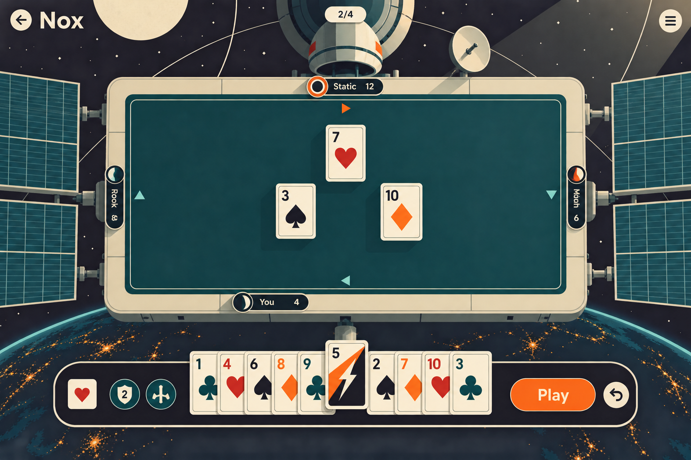

Self-check, first attempt: 1536x1024, one image in the run. Text limited to
the allowed words and illustrative names, scores, numerals and 2/4. Arrows
run clockwise, the viewer's tag sits left of centre, turn ring on Static,
trick nudged toward its players, ten cards with the lifted Storm 5
(tangerine and black with a bolt), heart die, shield 2, a four-pronged
Salvage token (the closest to a grappling hook this round), Play and Undo.
Solar wings, docking port and capsule, dish, orbit arcs, the moon, the night
Earth with city lights. Deviations: the side tags are turned sideways with
rotated text and Moth's name is garbled; the capsule and hull carry some
soft shading; the teal surface has faint grain.

### nox-frost-desktop-v1

Prompt: [`prompts/nox-frost-desktop-v1.txt`](prompts/nox-frost-desktop-v1.txt)

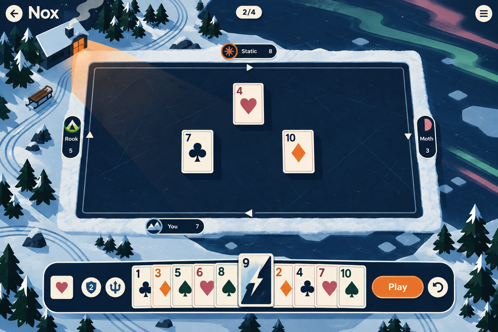

Self-check, first attempt: 1536x1024, one image in the run. Text limited to
the allowed words and illustrative names, scores, numerals and 2/4. Arrows
run clockwise, the viewer's tag sits left of centre, pill tags, turn ring on
Static, trick nudged toward its players, ten cards with the lifted Storm 9
(ice blue and navy with a bolt), heart die, shield 2, Play and Undo. Hut
window light as the one orange wedge, pine stars, ski tracks, sled, aurora
bands on the lake ice. Deviations: the Salvage token reads as a trident; the
snow bank and ice carry a little soft texture rather than pure flat colour;
the hut is drawn in shallow oblique (allowed for surroundings).

### nox-lateset-desktop-v1

Prompt: [`prompts/nox-lateset-desktop-v1.txt`](prompts/nox-lateset-desktop-v1.txt)

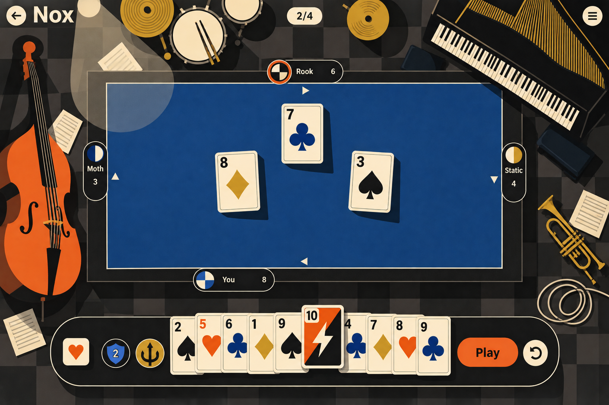

Self-check, first attempt: 1536x1024, one image in the run. Text limited to
the allowed words and illustrative names, scores, numerals and 2/4. Arrows
run clockwise, the viewer's tag sits left of centre, turn ring on Rook,
trick nudged toward its players, ten cards with the lifted Storm 10
(tangerine and black with a bolt), heart die, shield 2, Play and Undo. Drum
kit, grand piano, double bass, trumpet, cable, sheet music, checked floor,
one spotlight circle. Deviations: the Salvage token reads as a trident; side
tags are drawn vertical.

## Round 3: flat poster style, pirate themes

William: keep the flat poster style, but Nox stays pirate themed. Four pirate
settings, each drawn from its own poster tradition, with the same flat-shape
rules and game layout as round 2. Skulls, flags, ships and treasure are
allowed again, drawn as bold simplified graphic symbols rather than painted
loot. New in the layout: nothing may stand inside the play area, tag text
stays upright, each player's avatar is a flat pirate-flag emblem, and the
Salvage token is described shape by shape (shaft, four claws, ring).

- **Deck**: the main cargo hatch of a pirate ship at anchor under the moon
  (1950s swashbuckler film posters): masts and furled sails, cannons at the
  rails, the wheel, a spread black flag, one kraken tentacle over the rail.
- **Cove**: a salvaged hatch laid on the beach of a hidden island cove (1950s
  Caribbean travel posters): campfire light, palm stars, a careened ship,
  rowboats, a small chest, a parrot, the lagoon.
- **Tavern**: the long baize table of a harbour tavern after closing (1960s
  Polish and Czech film posters): barrels, a chandelier, a sleeping parrot
  and cat, a ship in a bottle, crossed cutlass and pistol, a porthole.
- **Chart**: the table is the open sea at the centre of a pictorial treasure
  map (1950s pictorial map posters): islands, a galleon, a sea serpent, a red
  dotted route to an X, a compass rose, a skull island, a whirlpool.

### nox-deck-desktop-v1

Prompt: [`prompts/nox-deck-desktop-v1.txt`](prompts/nox-deck-desktop-v1.txt)

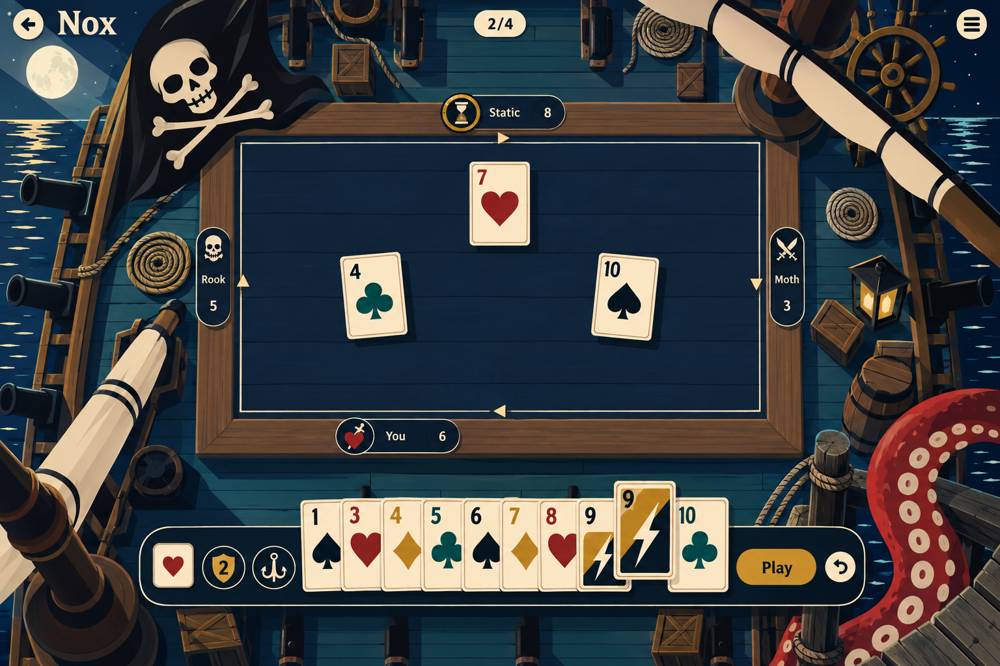

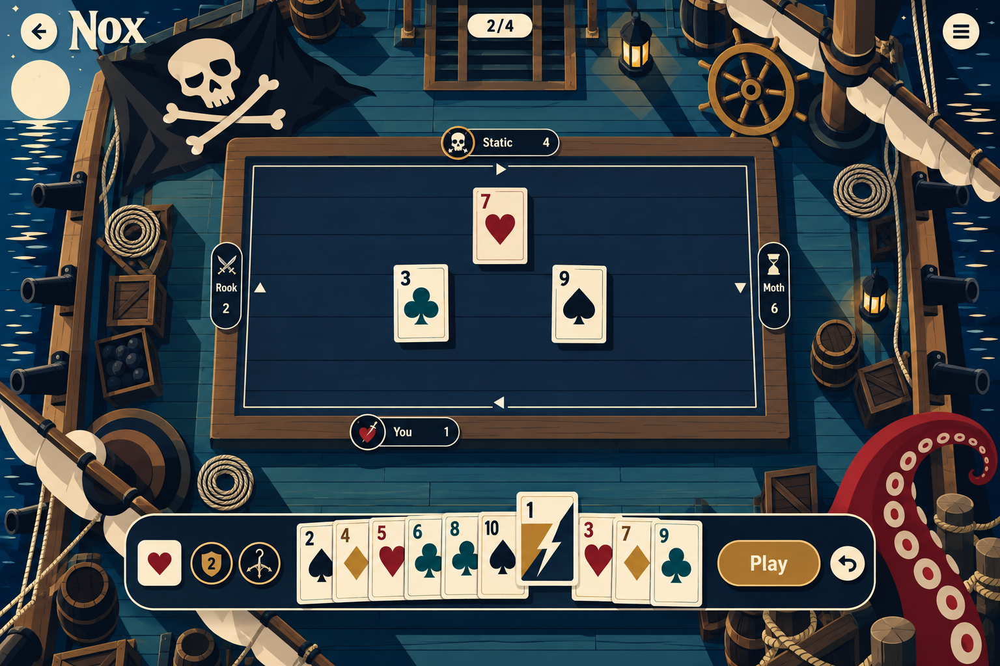

The Codex run called the image tool twice despite the one-call instruction
(session `01a0de86-977f-7f02-8c68-b24f791f72c7`): it saved the second image
as `nox-deck-desktop-v1.png`; the first is kept as
`nox-deck-desktop-v1-extra.png` so the paid generation is not lost.

Self-check: both 1536x1024. Text limited to the allowed words and
illustrative names, scores, numerals and 2/4. Arrows run clockwise, the
viewer's tag sits left of centre, flag-emblem avatars, turn ring on Static,
spread black flag, cannons, wheel, coiled ropes, furled sails, kraken
tentacle at the lower right. Deviations: both are more illustrated than flat
(wood grain, shaded barrels and masts, extra lanterns as second lights,
crates and barrels the brief did not ask for); `v1` shows the Storm 9 twice
in the hand and an anchor Salvage token; `v1-extra` has a cleaner hand and
the closest grappling hook so far.

### nox-cove-desktop-v1

Prompt: [`prompts/nox-cove-desktop-v1.txt`](prompts/nox-cove-desktop-v1.txt)

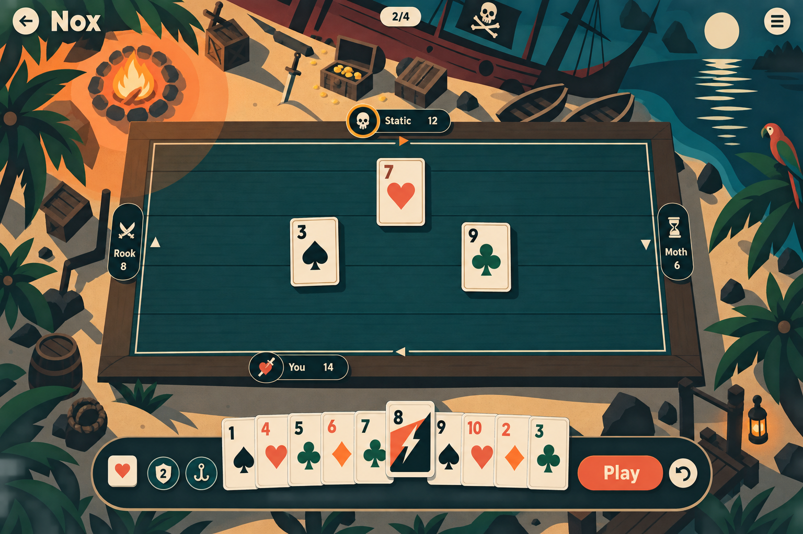

Self-check, first attempt: 1536x1024, one image in the run. Text limited to
the allowed words and illustrative names, scores, numerals and 2/4. Arrows
run clockwise, the viewer's tag sits left of centre, flag-emblem avatars,
turn ring on Static, lifted Storm 8. Misses the brief more than the others:
the table frame is drawn in slight perspective (wider at the bottom), the
scenery is a three-quarter view rather than a plan (side-view palms,
oblique ship and crates), there is visible grain, and the moon and a lantern
at the lower right compete with the campfire as light sources. The Salvage
token reads as an anchor.

### nox-tavern-desktop-v1

Prompt: [`prompts/nox-tavern-desktop-v1.txt`](prompts/nox-tavern-desktop-v1.txt)

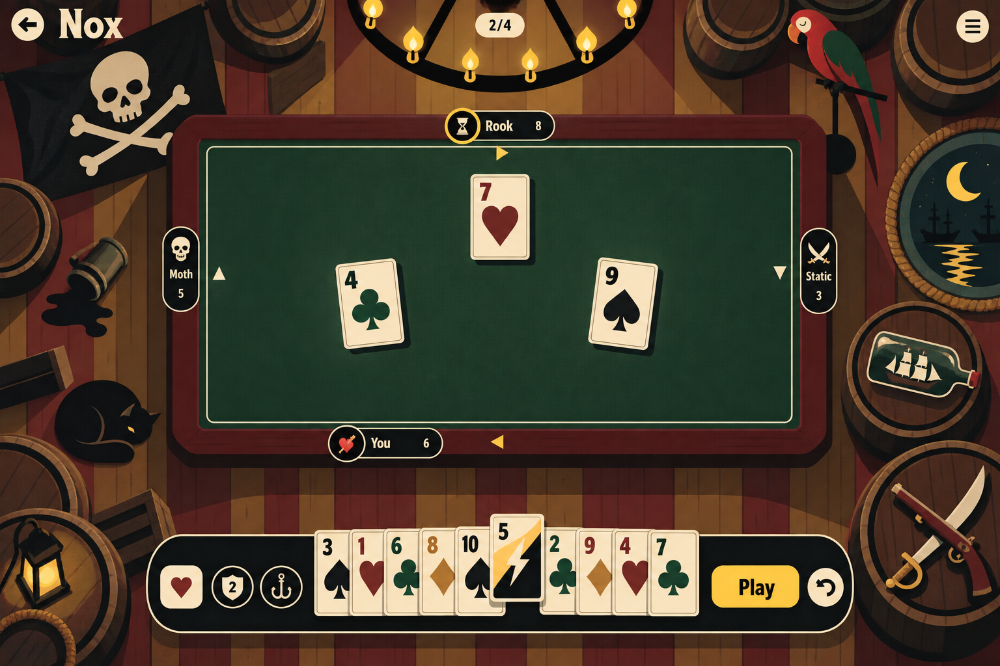

Self-check, first attempt: 1536x1024, one image in the run. Text limited to
the allowed words and illustrative names, scores, numerals and 2/4. Arrows
run clockwise, the viewer's tag sits left of centre, flag-emblem avatars,
turn ring on Rook, lifted Storm 5 (candle yellow and black), chandelier,
flag, parrot, cat, ship in a bottle, crossed cutlass and pistol on a barrel,
porthole with moon. Deviations: the model added a spilled tankard and a
lantern at the lower left (a second light); barrels carry soft shading, so it
is less strictly flat than Chart; the Salvage token reads as an anchor; side
tags are vertical.

### nox-chart-desktop-v1

Prompt: [`prompts/nox-chart-desktop-v1.txt`](prompts/nox-chart-desktop-v1.txt)

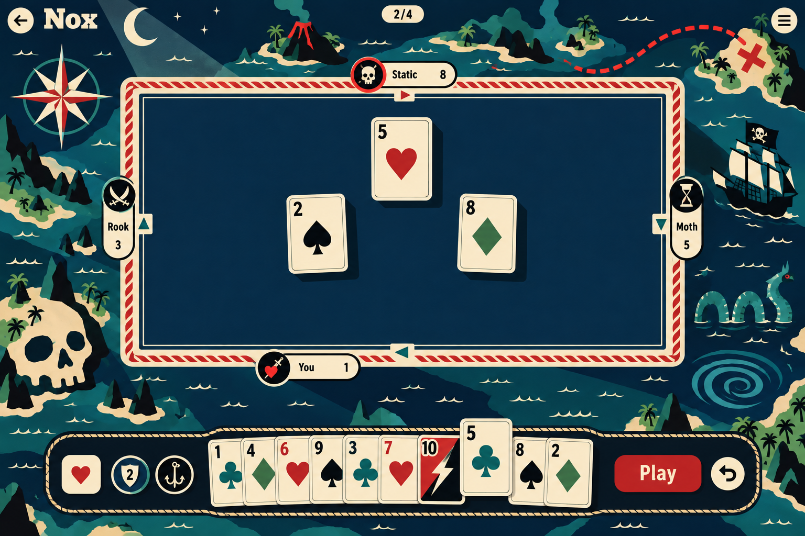

Self-check, first attempt: 1536x1024, one image in the run. Text limited to
the allowed words and illustrative names, scores, numerals and 2/4; no map
labels. Arrows run clockwise, the viewer's tag sits left of centre,
flag-emblem avatars (skull, crossed swords, hourglass, pierced heart), turn
ring on Static, cream-and-red rope rim, lifted 5 of clubs with a Storm 10
(red and black) in the hand. Compass rose, volcano island, red route to an
X, galleon with skull flag, sea serpent, whirlpool, skull island, moon wedge.
The flattest and most on-brief of the round. Deviations: the Salvage token
reads as an anchor; side tags are vertical.
