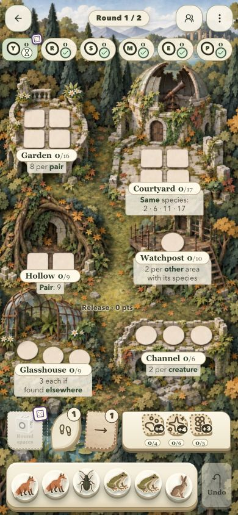
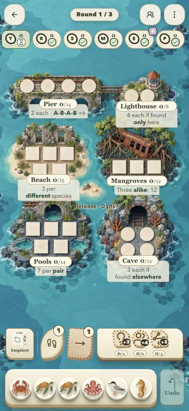
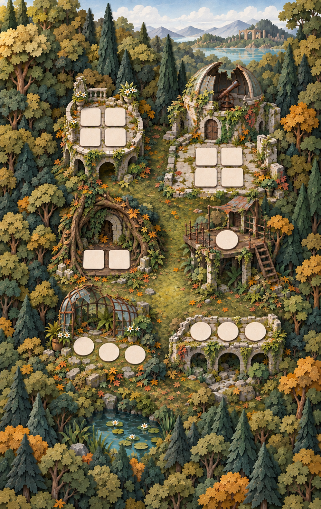
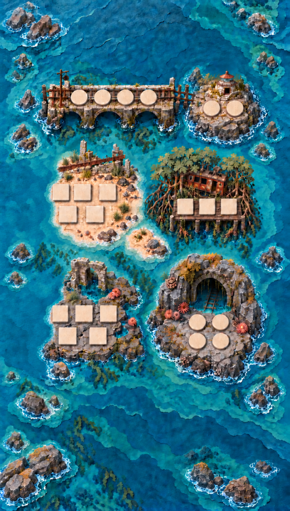

# Mora: clean mobile boards

## Latest: taller Floodline phone composition

Phones up to 600 CSS px wide now use fresh `mora-phone-floodline-v7-a` with
more space between rows and lower habitats extending farther toward the dock.
At 390×844, the lowest label centre moves from 553.19 to 609.02 px; creature
width stays 28.42 px. Portrait tablets retain v6-c and desktop retains its
landscape artwork. No image edits or references were used.

The phone source has its own measured metadata, and board rendering, targets,
camera, miniatures, loading and production packaging all select it together.
See [the v7 record](floodline-v7-review.md) for prompts, measured geometry and
the rejected alternative. The screenshots below are earlier v6 browser checks,
not verification of this latest phone composition.

All 41 focused layout/world tests, typecheck, lint, production assets and build
pass. The full suite reported 651 passes and 8 failures in the concurrently
modified audio subsystem. Those changes are outside this artwork task and were
preserved. Browser checks could not run: repeated connection attempts, including
a session reset, timed out. Physical touch is untested. Geometry passes all six
normal phones; two short-phone fixtures retain soft scenery margins.

## Follow-up review

The user accepted Observatory and requested its Watchpost and Glasshouse title,
score and explanation groups 4 CSS px lower. This is a portrait-only CSS offset;
Courtyard, the other labels and scene framing stay unchanged. Site-muted Chrome
checks at 390×844, 360×780 and 768×1024 confirmed the movement, with exactly 4 px
measured at 390×844 for both complete groups. The source-coordinate approach was
rejected because moving the lowest source label also changed the camera fit.

Floodline v5-g was rejected for degraded detail after repeated image edits. It is
preserved as history, not a quality reference. The global Codex AGENTS.md and the
project game-world-layout skill now require fresh text-only generations for every
candidate; image editing or image references require an explicit user request.

Floodline now uses `mora-phone-floodline-v6-c`, an independent fresh text-only
generation. The native source remains 946×1663 and the gameplay crop remains
140,273,690,949; creature width remains 28.42 CSS px at 390×844. Exactly 23 pads
were counted visually and measured. No reference input, edit pass, upscaling or
sharpening was used. See [fresh-generation provenance](floodline-v6-review.md).
Release was moved to source coordinate (480,835) after browser review to avoid
the middle-row explanation cards; the runtime JSON and reproduction script agree.

Site-muted Chrome verified the fresh board at 390×844, 768×1024 and 390×664.
The short phone now covers the viewport; labels are denser there, so this is not
physical-device or touch acceptance. Six-player badges and all three extensions
were enabled. Automated coverage passes all six full-height and three short-phone
fixtures. Complete landmark geometry passes phone and portrait-tablet fixtures.
The full suite passed 650 tests; after the art switch, the focused layout/world
suite passed 38 tests. Typecheck, lint, asset validation and build passed.

## Initial integration record (superseded for Floodline)

The two boards started as independent fresh built-in image generations, with
written style and geometry briefs and no old image references. Targeted edits of
those new sources corrected framing, peripheral silhouettes and Floodline's HUD
clearance. Earlier candidates remain available. The table below records the initial
integration; Floodline v5-g was subsequently rejected and replaced as noted above.

| Board | Source | Native size | Spaces | Creature width at 390×844 |
| --- | --- | --- | --- | --- |
| Observatory | `public/art/mora-phone-observatory-v5-c.png` | 997×1578 | 17 | 38.0 px, previously 38.1 px |
| Floodline | `public/art/mora-phone-floodline-v5-g.png` | 946×1663 | 23 | 28.4 px, previously 29.5 px |

The illustrations contain no horizontal explanation strips, plaques or paths
in front of the habitats. Gameplay slots, complete structural silhouettes and
label anchors were measured from the selected new sources. Full-scene WebP,
board and overview exports use the native source and the runtime JSON crops.
No mirrored, stretched or repeated scenery was added.

## Prompts and measurements

- Observatory: `observatory-prompt-v1.txt`, `observatory-prompt-v2.txt`,
  `observatory-prompt-v3.txt`; final `observatory-geometry-v3.json`,
  `observatory-framing-v3-corrected-interval.json`, `observatory-review-v3.md`.
- Floodline: `floodline-prompt.txt`, `floodline-correction-prompt.txt`,
  `floodline-perimeter-prompt.txt`, `floodline-local-trim-prompt.txt`,
  `floodline-flush-trim-prompt.txt`, `floodline-hud-height-prompt.txt`,
  `floodline-lighthouse-final-prompt.txt`; final `floodline-v5-g-draft.json`
  and `floodline-review.md`.
- Integration rounds habitat hit-box edges out to whole pixels; slot centres
  stay at the measured positions. Runtime metadata is authoritative.
- Floodline has 23 visually verified pads. Its final colour detector found 22;
  the lower-left beach pad was measured manually. Detector output alone is not
  the count acceptance gate.

## Layout and verification

The explanation panels use 4 px horizontal and 2 px bottom padding. Portrait
keeps only the top inset needed by the overlapping name pill. Text sizes remain
unchanged. Others keeps Roam, Migration and all three goals on one line, with
6 px minimum goal gaps; at 360 px and below it uses one opponent per row.

The shared camera previously reversed the feasible landmark-origin interval.
That interval is corrected, with a regression test requiring complete landmarks
to fit without changing the cover scale. New portrait regression checks cover
all six standard phone sizes and a 768×1024 tablet.

Normal full-height phones cover the viewport and show complete landmarks. Very
short phone windows retain the existing limitation: the game fits, but the scene
may need its soft background margin. These are explicitly reported rather than
counted as full-bleed acceptance.

Browser checks used a site-muted Chrome tab: both phone boards, compact labels,
six-player Others, keyboard goal inspection and focus return. The resource row
had no horizontal overflow at 320, 390, 768 and 1920 px. Physical touch, real-device
Safari and online multiplayer were not exercised in the browser.

Final validation: all 650 tests, TypeScript, lint, production asset validation
and the production build passed. HTTP tests and the build required execution
outside the filesystem sandbox because their local worker ports were blocked
there. The normal 390×844 Floodline view and 768×1024 tablet view were reviewed
again after the final lighthouse edit; the two roof/mast tops clear the phone
badges. Short phone windows and desktop rendering were also inspected, with
the short-window coverage limitation above retained.
