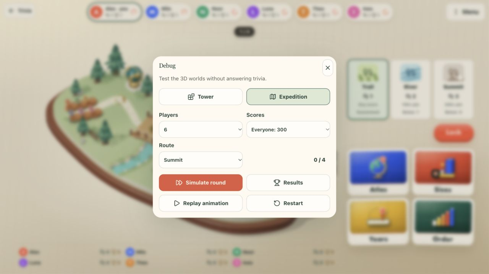
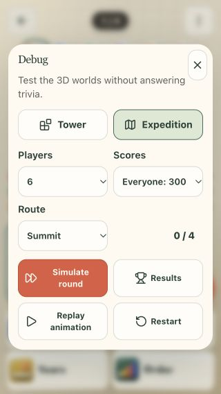
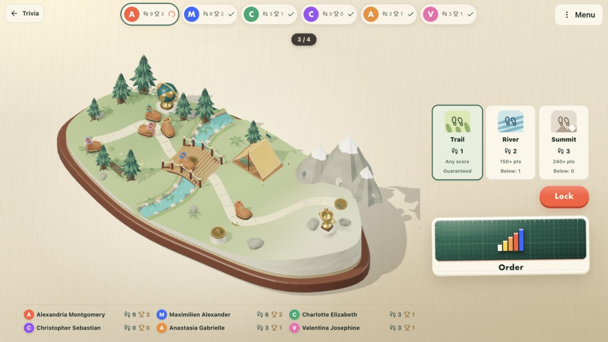
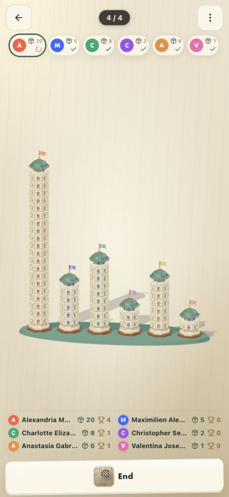
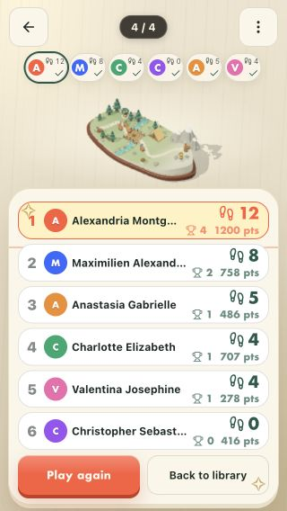

# Trivia Tower and Expedition, 4 October 2026

Large task: two authored 3D worlds, revised fixed-match rules and Expedition
interaction. The required [high-fidelity-3d skill](/Users/williamguinaudie/.codex/skills/high-fidelity-3d/SKILL.md)
and repository game-world-layout workflow informed the work. Written source
briefs precede modeling: [Tower](tower-brief.md) and
[Expedition](expedition-brief.md). This is agent review, not user approval.

## Rules and interaction

Both modes play **Atlas, Sizes, Years and Order once each**, in the host's
order. Every game remains a complete three-prompt round, up to 300 points.
Only unplayed games are offered. After the fourth round only the host ends.

Tower keeps one floor per hundred points and two extra floors for every round
winner, including tied winners. Tallest wins, then total points. New matches
can earn twenty floors.

The user chose **one route choice per round, with automatic steps and checkpoint
trophies** for Expedition. Trail always gives one step; River gives two at
150 points, otherwise one; Summit gives three at 240 points, otherwise none.
Each third step gives a trophy. Distance wins, then total points. Route plans
remain private until the next game starts; readiness is public. There are no
shop, supplies, currencies or purchases in new matches. The final camp does
not request another route lock.

`trivia.rules: 2` distinguishes new matches. Marker-absent Tower/Expedition
saves retain their original five/eight rounds, repeated-game choices and shop
accounting. The 3D source supports legacy Tower's twenty-five floors. Quick
Play and human-only production seats retain their established rules.

## Source quality and actual renderer

The root inspected material, side, rear and neutral clay source views. Tower
has complete octagonal architecture, real arched recesses, paired columns,
cornices, lacquer/brass steps, an open lantern, ribbed patina roof and attached
cloth. Its roof lifts, complete new tiers land and compress slightly, and the
roof settles within two seconds. No floor is represented by stretching a mesh.

Expedition has a continuous carved island and path, rooted pine clusters,
ferns/log detail, sculpted riverbanks, an arched joined bridge, tensioned sewn
tent, relief sundial, globe and mountain trophy. Leather traveller tokens have
soles, eyelets, laces, cuffs and seat-colour enamel. Ground/deck sampling and
surface normals plant their complete contact plates. Two spaced lanes prevent
six equal-progress tokens from overlapping; start/end queues stay inside the
landscape. Props are kept clear of the full traveller envelopes.
The final moving-envelope review covers 802 poses in both lanes and nine
rocking phases, using every authored token vertex; 7,986 footprint samples
have terrain/deck support. Low moss and fern contacts are intentional.

The scene is real Three.js/WebGL with environment reflections, directional
light and contact shadows. Portrait rotates Expedition's geography and brings
Tower into one compact row, protecting every base and crown. Projection fits
the landscape's source vertices instead of an oversized enclosing cuboid.
DPR starts at native quality, capped at two, and updates on resize/zoom.

Detailed editable source factories remain available. Only after root source
review were runtime copies enabled: static Expedition geometry is consolidated
by finish; settled Tower tiers instance their unchanged source geometry.
Animation groups, cloth, materials and triangle counts are retained. Starting
another build restores each source tier's own drop group.

| Actual six-player static WebGL view | Source calls | Runtime calls | Triangles in either view |
| --- | ---: | ---: | ---: |
| Twenty-floor towers | 410 | 74 | 4,146,258 |
| Expedition bridge queue | 856 | 120 | 305,488 |

These are cached-shadow, colour-pass observations from the canvas, including
scene furniture. Dynamic shadow passes add work while tiers/boots move. Idle
shadows are cached and ambient motion renders at thirty frames per second.
No geometry decimation or texture degradation was used. Draw-call reductions
do not establish physical mobile GPU performance.

The first visible render resets the animation clock after shader compilation
and geometry uploads. Fresh reload captures verify the complete travel and
Tower construction rather than allowing renderer startup to consume them.

The root compared retained-source and runtime screenshots at identical sizes.
Silhouettes, relief, finish and contacts match visually. JPEG pixel-difference
measurements and complete motion-frame captures are retained in `review/`.
The comparison checks rendering fidelity; it does not replace artistic review.

## Automated verification

- **81 focused tests pass** across the Trivia engine, setup, online privacy and
  persistence, all four games, shared feedback/motion, 3D source/runtime and
  reduced-motion hydration.
- Nine 3D tests check finite geometry, index/material ranges, 20/25 tiers,
  batch/source world transforms and triangles, retained moving attachments,
  fixed cloth anchors, ground/deck contacts, reduced motion and complete
  geometry/material/texture/renderer-owned source teardown.
- The shared count-up now reads the motion preference through React's external
  store with a stable server snapshot. Real server-render tests and browser
  reloads under reduced motion verify the hydration regression fix.
- Scoped TypeScript for the Trivia UI, scene, engines and their dependencies
  passes. Repository lint passes. Production build and asset validation pass:
  591 assets, 128.73 MiB, with the existing Docker allowlist verified.
- Full repository TypeScript remains blocked by the unrelated rejected Arena
  source `work/arena/2026-10-04-rebuild/sumo/rejected/sumo-v6-rejected.ts`
  (missing `./types` and three consequent implicit-argument types). That source
  was preserved.

The full-suite run reports **1,102 tests: 1,098 pass, 3 fail, 1 skip**.
The failures are unrelated to Trivia: Arena's Dino/ogre-jaw parapet contact
assertion, plus first-open and generation timing assertions in Folio Mines and
Sudoku. These do not establish a green full repository suite.
The Folio files pass **50/50 tests** when rerun alone with test concurrency one.
The Arena contact assertion remains a separate failure. Local listener
checks use listener access: sandbox `listen EPERM` does not establish a game
regression. No commit, push, merge or release is part of this task.

## Browser, keyboard and touch boundary

The development review bench uses valid real engine moves through all three
prompts, and the actual `StandaloneTable`, controls, rules and scene. It is
development-only. It does not expose a production solo/bot Trivia mode.

The root checked desktop, short desktop, tablet portrait, fractional breakpoint
viewport and phone portrait: **1280×720, 960×640, 960×540, 768×1024,
614×819, 390×844, 390×664 and 320×568**. Six long names, empty boards,
max-height/equal-height towers, equal-progress bridge queues, all four opening
choices, the last remaining game and six-player results were exercised.
Measured essential controls stay inside the viewport without page scroll or
overflow clipping. The smallest result screen initially failed; compact rows
and side-by-side final actions corrected it, and it was rechecked. The winning
row carries the result visually; the longer heading remains accessible.

Pointer route selection and keyboard Lock opened the complete fourth game with
three prompt tabs. Rules use the shared pieces, fit the phone overlay, and
Escape restores focus to Menu. Reduced motion settles 3D and score/reveal
animations without hydration warnings. Complete live construction/travel and
idle cycles were inspected in captured actual-renderer frames.

Touch-device emulation displayed the landscape-phone rotate screen. The in-app
browser cannot dispatch touch input, so route tapping/long-press and physical
touch were **not** verified in this pass; touch-target geometry and pointer/
keyboard operation were checked separately. Physical fullscreen/orientation
lock, a live six-human match and mobile GPU profiling remain untested. The
614×819 check crosses a responsive breakpoint; it is not an actual browser-zoom
interaction. Context-loss recovery and resource disposal are implemented; forced
GPU loss was not exercised in the browser.

## Debug menu follow-up

Medium task within Trivia's two fixed formats: local testing controls, no new
artwork or camera changes. The development menu's **Debug** opens an independent
lab from a live table; in the lab it opens a controlled dialog in place.
The direct entry is `/trivia/lab?mode=expedition&completed=0&debug`.

The panel switches Tower/Expedition, two to six seats, mixed/perfect/missed
scores and all three Expedition routes. **Simulate round** completes one
three-prompt round through valid engine moves; **Results** completes the
remaining rounds and the host's Finish. **Restart** clears only the lab match.
**Replay animation** remounts the real scene and repeats the last build/travel,
including completed results. The result animation override is development-only;
normal completed matches retain their established still world. Reduced motion
was checked on result replay: the real renderer reports still motion, settles
immediately and shows the complete finished journey.

**42 focused tests pass**, including twelve new helper tests. They cover exact
0/150/300 points in all four games, integer Years guesses across 32 seeds,
full rounds, existing progress and game order, save validation, immutable input,
locked answers/routes, partial reveals, maximum/tied outcomes for two to six
seats, Finish and restart. Scoped TypeScript and lint pass. No production build
or full-suite rerun was needed for this development-control change; the earlier
build and full-suite results above belong to the 3D/rules task.

The root exercised the real Menu/Debug dialog, current fourth-round Expedition,
fresh Tower round, both perfect four-round results, mode/player switches and
replay. At **320×568, 390×664, 768×1024, 960×540 and 1280×720**, every debug
control fits with no dialog scrolling. Pointer/native selects and keyboard
dismissal/focus restoration are checked. Physical touch was not checked.
The root inspected complete replay frames in the actual renderer: the captured
result travel is animated and settles normally. No asset, material or camera
optimization was introduced by this follow-up.

## Review evidence

Source/runtime pairs, side/rear/clay, tablet/short-phone views, motion frames,
canvas statistics and viewport measurements are preserved beside these images.
