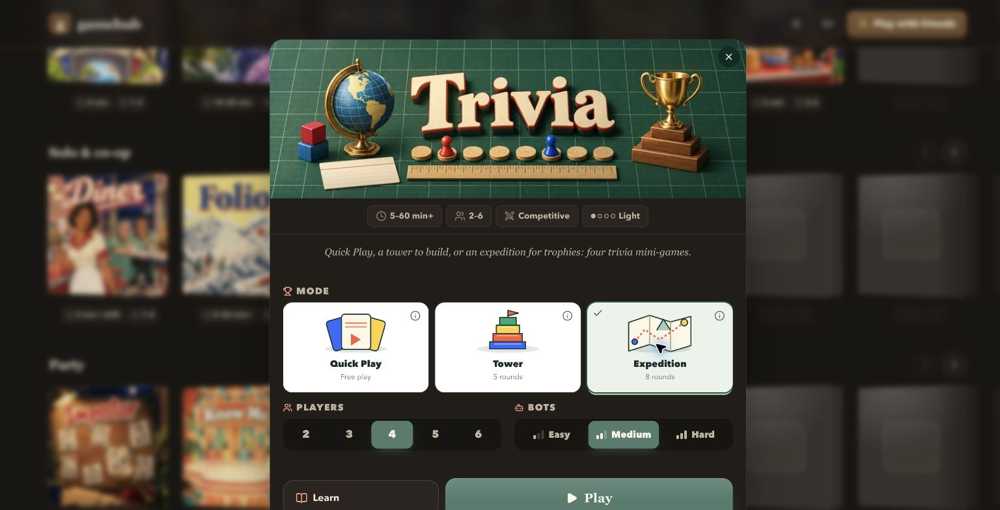
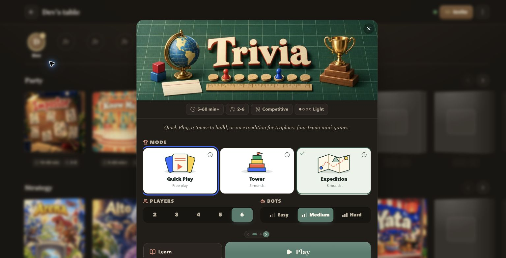
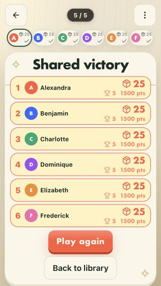

# Trivia implementation, 4 October 2026

This records the initial three-mode implementation. The later four-round rules,
streamlined Expedition and actual 3D worlds supersede the Tower/Expedition
descriptions below; current evidence is in the
[3D implementation record](../2026-10-04-trivia-3d/verification.md).

Quiz is now **Trivia**, keeping the `miro` internal id and existing saves.
Atlas, Sizes, Years and Order are the mini-games inside three match formats:

| Mode | Match | Goal |
| --- | --- | --- |
| Quick Play | Host picks games and when to end, up to 12 rounds | Most total points |
| Tower | 5 rounds | Tallest tower; points break ties |
| Expedition | 8 rounds with private route and purchase plans | Most trophies; distance, coins, then points break ties |

The complete rules are in [DESIGN.md](../../DESIGN.md), the shared rule
components and `lib/games/party/trivia.ts`. Fresh artwork, original sources,
exact prompts and crop checks are recorded in
[the cover record](../2026-10-04-trivia-covers/README.md).

## Automated checks

- 57 focused tests pass across `trivia`, `trivia-online`, `trivia-setup`,
  `sabi`, `know-me-quiz`, `size` and `geography`.
- Coverage includes all three scoring formats, tied winners, camp readiness,
  host-only advancement, private plans and guesses, atomic purchases,
  reload-safe accounting, older saves, server configuration, persistence,
  mode handoff, human-only production seats and server-safe hydration.
- Typecheck, repository lint and production build pass. The production asset
  check verifies 591 assets and the Docker allowlist, totaling 128.73 MiB.
- Full-suite run: 1,055 tests, 1,052 pass, 3 fail. Two failures are in the
  concurrent Arena work (`arena-animation.test.mjs`, rounded-corner contact
  and the Dino/Sumo free-stride regression). The third is Folio's 50 ms
  timing assertion. All 28 `folio-waffle` tests pass on an isolated rerun.
  These results do not establish a green full repository suite.

## Browser and touch checks

Checked the real library setup and online lobby against an isolated local
database. The selected mode reaches new and existing owned lobbies, opens
setup without starting a game, and consumes the mode query once.

Engine-generated match fixtures exercised the mode boards, Expedition route
and purchase changes, lock/host handoff, the last camp, and results. Separate
maximum-value fixtures checked the six-player badge row and exact ties.
The temporary preview route was removed after testing.

Desktop, short desktop landscape, tablet portrait and phone portrait were
checked, including 1280×720, 960×540, 768×1024, 614×819, 390×844,
390×664 and 320×568. Six long names and high scores fit the narrow phone
badge row; all three modes' results fit 320×568 without table scrolling.
The 614×819 check crosses a responsive breakpoint; it is not proof of an
actual browser zoom change.

Chrome touch emulation verified selection, long-press rule inspection,
preserved mode selection and restored focus. Keyboard inspection and
Escape were checked separately. Landscape phone emulation showed the
rotate screen. Reduced-motion emulation disabled result animations.

This is emulated touch and layout verification, not physical-device testing
or a live match with six people. Multiplayer rules and hidden decisions were
checked through the server tests. Fullscreen and orientation-lock support on
physical phones were not reverified.

## Review images

The setup screenshots use development previews, where the existing developer
bot controls are visible. Production Trivia requires human players.

